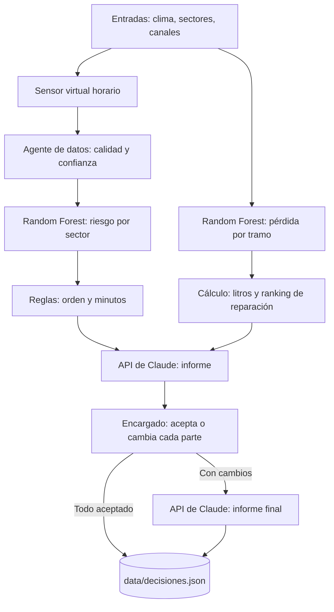

# Asistente Inteligente de Riego Intrafinca — Mendoza

Prototipo académico que ayuda al encargado de una finca con riego por gravedad a decidir cómo repartir un turno de agua limitado y qué tramos de canal conviene reparar. El sistema analiza, explica y propone. **La decisión es siempre de la persona, y las compuertas se operan a mano.**

> **Datos de prueba.** Los sensores son virtuales y los datos, sintéticos. No hay validación de campo: las métricas miden la simulación, no una finca real.

## El problema

En Mendoza el riego por gravedad funciona por turnos: durante unas horas llega un caudal fijo y hay que decidir qué sectores regar primero y cuánto, con información incompleta. Además, parte del agua se pierde en los canales antes de llegar. Este prototipo junta esa información y la convierte en una propuesta que se puede discutir.

## Qué hace

| Pestaña | Para qué sirve |
|---|---|
| **Resumen** | Indicadores principales, mapa y recomendación del turno. |
| **Mapa de la finca** | Mapa isométrico: la altura de cada bloque indica el riesgo y el canal se afina según el agua que queda. Permite agregar, quitar y mover sectores (1 a 10) y guardar la distribución. |
| **Clima y simulación** | Escenarios (Normal, Zonda, Falla de sensor, Canal deteriorado), clima de la finca y sonda virtual del sector elegido, con controles para probarla. |
| **Canales** | Recorrido del agua, pérdida por tramo y ranking de reparaciones. |
| **IA** | Informe, decisión por partes y confirmación. Se detalla abajo. |

### El flujo de la pestaña IA

1. **Informe.** CONSULTAR A LA IA genera un informe con pérdidas significativas, reparto del agua e inversión en reparaciones. Se lee por solapas, junto con cómo se llegó a cada resultado.
2. **Decisión por partes.** El reparto del agua y la reparación sugerida se deciden por separado. El reparto se puede editar sector por sector, siempre que los minutos sumen el turno. Ante un desacuerdo se le puede pedir opinión a la IA sobre esa parte.
3. **Confirmación.** Si hubo cambios, la IA rehace el informe con ellos y se comparan propuesta y versión final antes de guardar.

Lo aceptado se guarda con fecha en `data/decisiones.json`, con el valor original, el final y el motivo de cada parte. Lo rechazado no se guarda.

## Cómo se usa la IA

| Componente | Tipo | Función |
|---|---|---|
| Riesgo con sensor | Random Forest (scikit-learn) | Estima el riesgo de déficit hídrico con clima, NDVI, historial y lecturas de la sonda. |
| Riesgo sin sensor | Random Forest | Estima el riesgo cuando no hay lectura. Nunca inventa humedad, y la confianza baja. |
| Pérdida por tramo | Random Forest | Estima el porcentaje de agua que pierde cada tramo de canal. |
| Informe y opinión | API de Claude (`claude-opus-5-5`) | Redacta el informe, opina sobre los desacuerdos y lo rehace con los cambios. **No calcula ninguna cifra.** |

Se usan modelos locales para los números porque son reproducibles y no dependen de internet. El modelo de lenguaje se usa para lo que ellos no hacen: explicar los resultados y conversar sobre ellos.

## Arquitectura



La opción futura de reemplazar el sensor virtual por sondas reales no está implementada.

## Instalación

Requiere Python 3.12 o superior. Se probó en macOS con Python 3.12; en Windows no se probó.

```bash
python3 -m venv .venv
source .venv/bin/activate
python -m pip install -r requirements.txt
```

También están `iniciar_linux_mac.sh` e `iniciar_windows.bat`, que instalan y arrancan la app.

### Clave de la API

El informe de la IA necesita una clave propia de Anthropic. **Cada integrante usa la suya.**

```bash
cp .env.example .env
```

Después se completa `ANTHROPIC_API_KEY` dentro de `.env`.

**`.env` está en `.gitignore` y nunca debe subirse al repositorio.** Sin clave, la app funciona igual, salvo el informe y las opiniones de la IA. Los números se calculan localmente, y la decisión se puede tomar igual.

### Ejecutar

```bash
python app.py
```

Abrir <http://127.0.0.1:7860>.

## Pruebas

```bash
python -m unittest discover -s tests
```

Con la app corriendo en otra terminal, la prueba completa contra Gradio:

```bash
python -m tests.smoke_gradio
```

Las pruebas no llaman a la API de Claude ni escriben en el historial real.

## Datos, costos y privacidad

- **Qué se envía a Anthropic:** riesgos, cultivos, superficies, entradas de los modelos, pérdidas, costos de reparación y lo que escribe el encargado. No se envían datos personales del usuario.
- **Qué queda local:** la configuración de la finca (`data/finca_config.json`) y las decisiones (`data/decisiones.json`, que no se sube a git).
- **Costo:** cada consulta, opinión o informe rehecho es una llamada facturada a la clave configurada (`claude-opus-5-5`: USD 4 por millón de tokens de entrada y USD 20 por millón de salida).
- **Seguridad:** la clave se lee solo desde `.env`. Los mensajes de error de la app no la muestran.

## Límites conocidos

- Los modelos se entrenan con datos sintéticos. El riesgo tiende a saturarse cerca de 100.
- El mapa es un croquis relativo: no usa GPS ni calcula áreas reales. Sus líneas a los sectores son asociaciones lógicas, no un reparto hidráulico.
- Los modelos no recalculan riesgo ni pérdidas con los minutos editados por el encargado.
- Los modelos de riesgo no usan el tipo de cultivo.
- Que una reparación recupere el 70% de la pérdida es un supuesto, y la meta de ahorro del 15% es una hipótesis. Ninguno está validado.
- El umbral de 20% para "pérdida significativa" es una convención del prototipo.
- Los rechazos y los sectores efectivamente regados no se registran.

## Estructura

```text
app.py                     Interfaz y eventos de Gradio
assets/dashboard.css       Estilos
core/simulation.py         Orquestación del análisis
core/sensors.py            Sensor virtual horario
core/synthetic_data.py     Datos de demostración y entrenamiento
core/ai_models.py          Random Forest y métricas
core/agents.py             Calidad, diagnóstico, prioridad y auditoría de canales
core/explicacion_ia.py     Llamadas a la API de Claude
core/decision.py           Decisiones por partes e historial
core/farm.py               Geometría y configuración local
core/farm_map.py           Mapa isométrico
core/visuals.py            Tarjetas, gráficos y componentes del informe
data/                      CSV de demostración y configuración
tests/                     Pruebas de regresión y smoke
docs/                      Documentación de etapas y guía de defensa
```

## Equipo

1. Juan Ignacio Lozano: base funcional, simulador e interfaz.
2. Gian Franco Siccardi: IA, integración con la API y flujo de decisión.
3. Jeremías Sosa: agentes, decisiones y trazabilidad.
4. Santiago Rivamar: integración final y entrega.

**Uso de IA en el desarrollo:** ChatGPT y Claude Code apoyaron la implementación, la revisión y la documentación. El equipo debe verificar los supuestos antes de entregar.
